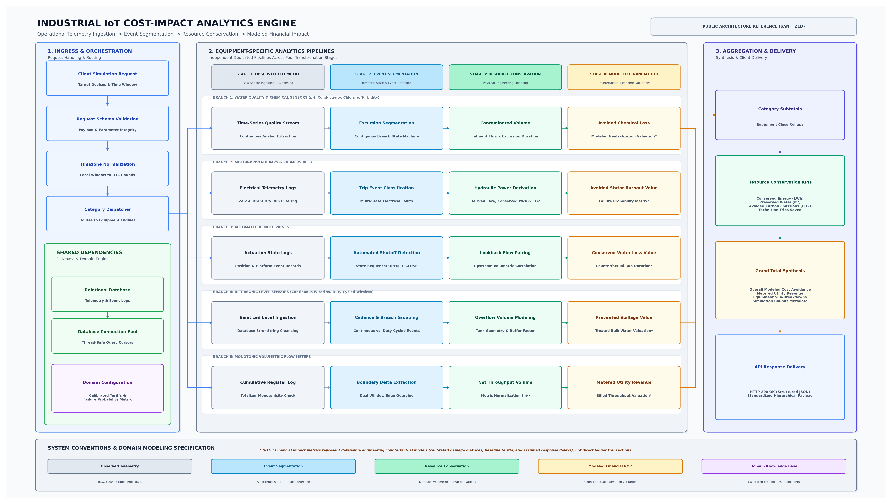
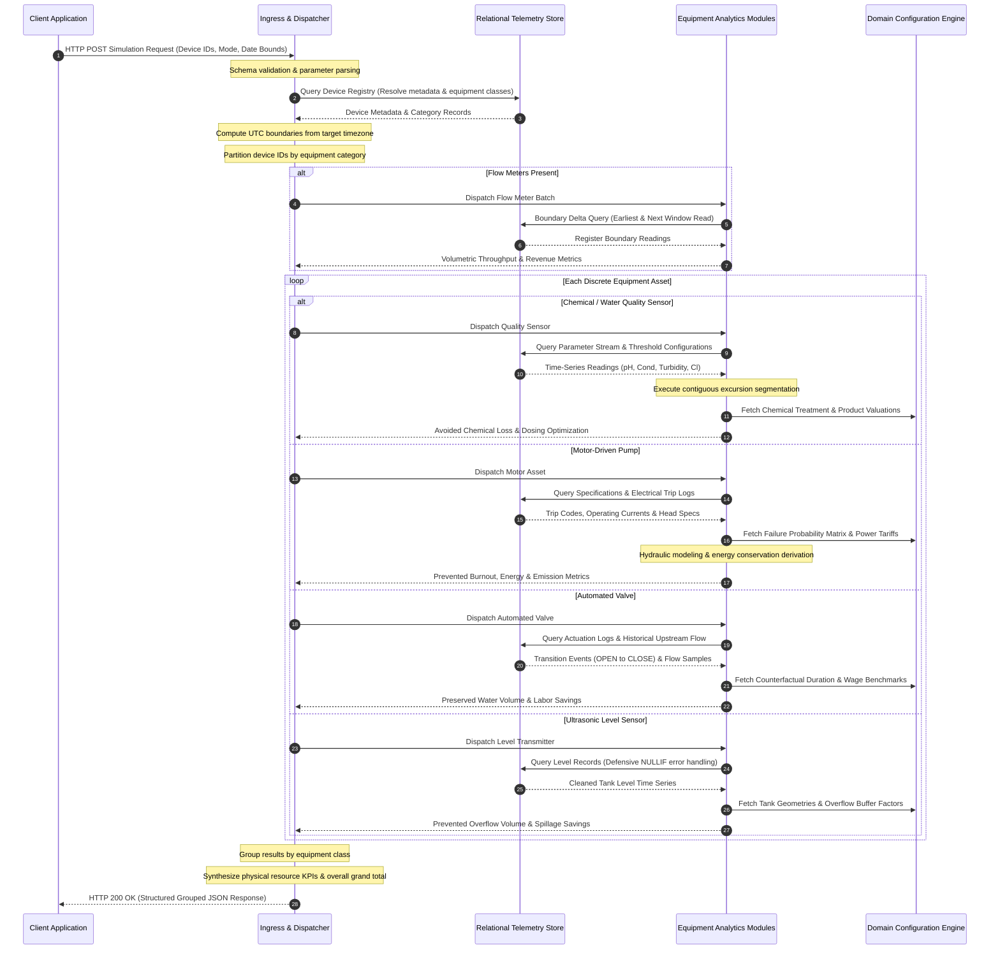

# Engineering Case Study: Industrial IoT Cost-Impact Analytics Backend

**Role:** Backend Analytics Engineer & Data Systems Architect  
**Domain:** Industrial Water Infrastructure IoT, Telemetry Processing & Operational Financial Modeling  
**Technologies:** Python, FastAPI, PostgreSQL, SQLAlchemy, Raw SQL, Pydantic, NumPy, pytz  
**Scope:** Analytical Microservice Architecture, Time-Series Event Segmentation, Physical Derivations, Counterfactual Financial Modeling, REST API Contracts  

---

## 1. Project Overview

### The Industrial IoT Context
In municipal water utilities, wastewater processing facilities, and industrial fluid networks, supervisory control and data acquisition (SCADA) and modern Industrial Internet of Things (IIoT) platforms continuously monitor critical infrastructure assets. These physical assets include:
- Motor-driven submersible and centrifugal pumps.
- Motorized automated flow-control valves.
- Water-quality analytical sensors (measuring pH, conductivity, turbidity, and dissolved chlorine).
- Ultrasonic tank level transmitters.
- Monotonic volumetric flow meters.

Field devices emit continuous, high-frequency operational telemetry: phase voltages, operating currents, fault trip indicators, actuator state flags, analog quality metrics, hydrostatic tank levels, and cumulative volumetric odometer readings.

```
+───────────────────────────────────────────────────────────────────────────────────────────────────+
|                                  MONITORING vs. IMPACT QUANTIFICATION                             |
+───────────────────────────────────────────────────────────────────────────────────────────────────+
|  OPERATIONAL MONITORING (SCADA / Telemetry)   │  COST-IMPACT ANALYTICS (Engineering Backend)      |
|  • "Is Pump 04 currently running?"            │  • "What did automated trip prevention save?"    |
|  • "What is the pH in Settling Tank B?"       │  • "How much chemical waste was averted?"        |
|  • "Did Valve 12 close at the setpoint?"      │  • "What volume of treated water was conserved?" |
|  • Binary status & real-time threshold alarms │  • Physical resource savings & counterfactual ROI |
+───────────────────────────────────────────────────────────────────────────────────────────────────+
```

### The Analytical Gap: Monitoring vs. Impact Quantification
Traditional industrial monitoring platforms excel at operational visibility: they display current readings on dashboards and raise alarms when parameters cross static thresholds. However, plant managers, utility directors, and executive leadership face an analytical gap: **quantifying the tangible financial and physical resource return on investment (ROI) generated by automated operational decisions.**

When an automated platform instantly trips a pump upon detecting dry-run cavitation, closes an automated valve during an upstream line rupture, or flags a severe chemical excursion before water enters distribution networks, the system creates quantifiable business value. Traditional telemetry platforms do not measure this value because:
1. **Raw Telemetry Cannot Be Directly Summed:** Accumulators (odometers) wrap, reset, and represent monotonically increasing registers rather than per-interval consumption. Summing odometer values corrupts analytical totals.
2. **Analog Sensor Streams Lack Inherent Event Boundaries:** Continuous pH or turbidity streams fluctuate across normal and anomalous bands. Quantifying an operational failure requires continuous temporal state machines that segment raw time series into contiguous excursion episodes.
3. **Financial Value Requires Counterfactual Modeling:** An averted disaster leaves no direct invoice. Measuring avoided asset damage (motor stator burnout), avoided chemical treatment waste, or conserved treated water volume requires defensible, domain-calibrated counterfactual modeling ("What resource loss would have occurred under traditional manual intervention delays?").

### Objective of the Analytics Backend
The objective of this project was to design and implement an **on-demand, high-performance Cost-Impact Analytics Backend**. The service processes raw, multi-tenant IoT notification records from a relational database, executes domain-specific event segmentation and physical engineering equations, applies calibrated financial assumptions, and returns hierarchical, grouped impact assessments through REST APIs.

---

## 2. Business and Technical Problem

Translating raw field telemetry into actionable operational insights requires solving distinct data engineering and analytical challenges:

```
+───────────────────────────+     +───────────────────────────+     +───────────────────────────+
|   OBSERVED FIELD TELEMETRY|     |   DERIVED PHYSICAL METRICS|     |  MODELED FINANCIAL IMPACT |
|   • Voltage, Current      |     |   • Conserved Energy (kWh)  |     |   • Avoided Stator Burnout|
|   • Trip Codes            | ──► |   • Conserved Water (m³)    | ──► |   • Conserved Power Tariff|
|   • Analog pH / Chlorine  |     |   • Contaminated Batch (m³) |     |   • Avoided Chemical Loss |
|   • Cumulative Flow Delta |     |   • Avoided Emissions (CO₂) |     |   • Labor Dispatch Savings|
+───────────────────────────+     +───────────────────────────+     +───────────────────────────+
```

### 1. Continuous Analog Sensor Streams
Water quality sensors (pH, chlorine, conductivity, turbidity) produce continuous analog time-series data. A single abnormal reading does not necessarily constitute an operational emergency; sensor noise, baseline fluctuations, and wash cycles occur regularly. The analytics engine must reconstruct contiguous excursion episodes from discrete timestamped records, tracking the exact start, duration, severity, and resolution of each out-of-spec event.

### 2. Discrete Equipment State Transitions
Automated valves and motor starters generate event logs rather than continuous analog curves. An actuation event consists of discrete transition logs (such as transitions between open and closed states). The analytics engine must isolate transitions triggered by automated supervisory logic from those initiated by manual operator overrides, identifying true automated protective interventions.

### 3. Non-Additive Cumulative Registers
Flow meters record cumulative volumetric registers (similar to vehicle odometers). A standard SQL aggregation (`SUM(totalFlow)`) would produce mathematically meaningless numbers orders of magnitude larger than actual flow. The engine must extract exact boundary deltas across the specified temporal window while defending against odometer resets, rollovers, and meter replacements.

### 4. Missing, Delayed, and Malformed Telemetry
Field IoT hardware operates in harsh physical environments subject to intermittent network connectivity, power outages, and sensor faults. Telemetry records often contain:
- Hardware-specific error strings (such as transducer echo loss) stored in place of floating-point numbers.
- Sporadic notification intervals with varying transmission cadences.
- Null sensor fields during warm-up or communication retries.

The ingestion pipeline must sanitize malformed records defensively without crashing aggregate queries or corrupting time-series calculations.

### 5. Heterogeneous Equipment Sampling Behaviors
Different hardware categories operate under distinct energy and bandwidth constraints:
- **Mains-Powered Continuous Devices:** Transmit telemetry on continuous, high-frequency intervals.
- **Battery-Powered Wireless Devices:** Sleep between reporting cycles to preserve battery life, reporting periodically.

A universal calculation loop fails across heterogeneous hardware cadences. The backend requires dedicated analytical branches calibrated to the operational characteristics of each device category.

### 6. Counterfactual Financial Modeling
Direct financial ledgers record only actual expenditures; they do not record losses that were successfully prevented. Evaluating the value of automation requires modeling counterfactual scenarios:
- *Without automated pump cutoff, how long would a pump have run dry before an operator physical round discovered it?*
- *What is the domain probability that continuous dry running burns out the motor windings?*
- *What volume of treated water would be lost during manual valve dispatch travel?*

The system must clearly separate directly observed physical metrics from counterfactual economic models so that engineering rigor is maintained.

---

## 3. Solution Overview

The Cost-Impact Analytics Engine is built as a modular microservice designed to bridge raw field telemetry and executive decision-making.

```
+───────────────────────────────────────────────────────────────────────────────────────────────────+
|                                    ANALYTICAL TRANSFORMATION PIPELINE                             |
+───────────────────────────────────────────────────────────────────────────────────────────────────+
|                                                                                                   |
|  1. Ingestion & Validation   ──► Validates request payload, parameters, and time boundaries       |
|  2. Metadata Scoping         ──► Identifies equipment classes and multi-tenant enterprise filters |
|  3. SQL Boundary Extraction  ──► Fetches normalized time-series slices via connection pool       |
|  4. Telemetry Sanitization   ──► Casts values defensively and strips hardware fault strings       |
|  5. Event Segmentation       ──► Reconstructs contiguous excursion states & trip sequences        |
|  6. Physical Derivations     ──► Calculates flow rates, conserved kWh, and batch volumes          |
|  7. Economic Modeling        ──► Applies calibrated damage matrices, tariffs, and wage costs      |
|  8. Hierarchical Rollup      ──► Assembles equipment subtotals and overall simulation totals      |
|                                                                                                   |
+───────────────────────────────────────────────────────────────────────────────────────────────────+
```

### Core Capabilities
1. **On-Demand High-Throughput Calculation:** Executes calculations at request time across multi-device selections without relying on brittle pre-computed aggregation tables.
2. **Timezone-Aware Temporal Windowing:** Localizes calendar periods (`daily`, `weekly`, `monthly`, `yearly`, `alltime`, and `custom`) to the target plant timezone before transforming boundaries into standardized UTC queries.
3. **Defensive Data Pipelines:** Utilizes parameterized raw SQL cursors and database-level type sanitization to handle millions of notification rows efficiently.
4. **Physical Engineering Derivations:** Uses first-principles fluid mechanics, hydraulic power curves, and mass conservation principles to calculate unmetered physical metrics.
5. **Calibrated Economic Assumptions:** Maintains a centralized domain configuration engine containing equipment replacement costs, failure probability tables, baseline energy tariffs, chemical treatment costs, and labor rates.
6. **Strict Separation of Concerns:** Distinctly classifies outputs as:
   - *Directly Observed Telemetry* (sensor readings, timestamps, raw totalizers).
   - *Derived Operational Events* (trip counts, excursion durations, state changes).
   - *Calculated Resource Conservation* (conserved kilowatt-hours, preserved water volume, averted carbon mass).
   - *Modeled Financial Impact* (estimated cost avoidance based on configured counterfactual assumptions).

---

## 4. System Architecture

The backend adheres to a layered microservice pattern, separating network protocol handling, validation, database access, equipment analytics, and response synthesis into decoupled layers.



### Architectural Components

```
+───────────────────────────────────────────────────────────────────────────────────────────────────+
|                                    LOGICAL COMPONENT ARCHITECTURE                                 |
+───────────────────────────────────────────────────────────────────────────────────────────────────+
|                                                                                                   |
|  [ API Layer ]                  FastAPI HTTP Routers & Endpoint Handlers                          |
|         │                                                                                         |
|         ▼                                                                                         |
|  [ Request & Validation ]       Pydantic Schema Validation & Temporal Window Engine               |
|         │                                                                                         |
|         ▼                                                                                         |
|  [ Dispatcher & Partitioning ]  Device Metadata Resolution & Equipment-Class Partitioning         |
|         │                                                                                         |
|         ├────────────────────────────────────────┬────────────────────────────────────────┐       |
|         ▼                                        ▼                                        ▼       |
|  [ Shared Persistence ]               [ Analytics Pipelines ]                  [ Domain Engine ]  |
|  • PostgreSQL Telemetry Store         • Water Quality Analytics Pipeline       • Physical Constants|
|  • Connection Pool (QueuePool)        • Motor & Pump Analytics Pipeline        • Damage Matrices  |
|  • Parameterized Raw SQL Cursors      • Automated Valve Analytics Pipeline     • Baseline Tariffs |
|                                       • Ultrasonic Level Pipeline              • Labor Benchmarks |
|                                       • Flow Meter Analytics Pipeline                             |
|                                                  │                                                |
|         ┌────────────────────────────────────────┘                                                |
|         ▼                                                                                         |
|  [ Aggregation & Egress Layer ] Subtotal Rollups, Physical KPI Synthesis & Grouped JSON Payload   |
|                                                                                                   |
+───────────────────────────────────────────────────────────────────────────────────────────────────+
```

#### 1. API Layer
Exposes REST endpoints that client dashboards invoke to discover monitored enterprises, list operational devices, and initiate multi-device simulations. The API layer enforces HTTP status conventions, standardized error responses, and CORS policies.

#### 2. Request Validation and Filtering
Parses incoming simulation requests through strict schema validators. Validates device array lengths, checks temporal simulation modes, parses start and end dates, and verifies timezone compatibility.

#### 3. Dispatcher and Partitioning
Queries the device registry to resolve equipment classes for requested device identifiers. Partitions requested assets into dedicated processing queues (e.g., isolating flow meters for unified batch calculation while routing pumps, valves, quality sensors, and level transmitters to dedicated analytical workers).

#### 4. Shared Persistence Layer
Manages pooled connections to the underlying relational database using an engine pool configured with automatic reconnection checks. Uses parameterized cursors rather than heavyweight ORM object instantiation, minimizing memory allocation when processing tens of thousands of time-series records per request.

#### 5. Equipment-Specific Analytics Modules
Five distinct analytical pipelines encapsulate domain-specific physics, event segmentation algorithms, and data cleansing logic. No generic calculation block is shared across disparate equipment types.

#### 6. Domain Configuration Engine
Serves as the single source of truth for physical constants (gravitational acceleration, fluid density), equipment conversion factors (mechanical-to-electrical efficiency ratios), failure probability distributions across trip codes, baseline utility tariffs, and operator labor rates.

#### 7. Financial Modeling Layer
Transforms derived physical quantities (kilowatt-hours saved, cubic meters of water preserved, trip event frequencies) into monetary impact estimates using standardized, defensible counterfactual scenarios.

#### 8. Aggregation and Response Layer
Assembles analytical outputs into a hierarchical response structure: per-device analytical cards, equipment-class subtotals, aggregated physical resource conservation totals, and an overall simulation grand total.

---

## 5. End-to-End Data Flow

The simulation workflow processes requests synchronously from client invocation to response delivery.



### Detailed Execution Stages

1. **Request Reception:** An incoming HTTP POST payload contains target device identifiers, a temporal mode, and optional date strings.
2. **Input Validation:** A request schema enforces valid mode values and ensures device arrays are populated.
3. **Enterprise & Equipment Identification:** The backend queries the database registry to resolve device names, categories, and enterprise scoping.
4. **Time-Window Selection:** A timezone engine converts local calendar boundaries into strict UTC timestamps formatted for SQL comparison.
5. **Telemetry Retrieval:** Parameterized SQL queries pull raw sensor notifications within the calculated UTC window, performing inner joins between event metadata and sensor payload tables.
6. **Data Cleaning & Normalization:** Hardware-specific error flags are converted to null values, timestamps are normalized, and volumetric units are converted to standard metric units.
7. **Equipment-Specific Analytical Processing:** Telemetry enters dedicated analytical engines corresponding to equipment classes.
8. **Event Detection & Segmentation:** Algorithms detect discrete operational events (electrical trip codes, acute water quality excursions, automated valve closures, tank overflow breaches).
9. **Operational & Resource Calculations:** Physical equations derive unmetered quantities: hydraulic discharge flow, conserved electrical energy, and contaminated liquid volumes.
10. **Financial Impact Estimation:** Calibrated domain parameters translate physical metrics into modeled monetary cost avoidance.
11. **Result Aggregation:** The engine computes category subtotals and aggregates physical resource metrics across all processed devices.
12. **API Response Construction:** A hierarchical JSON payload delivers per-device calculations, category summaries, and grand totals to the client.

---

## 6. Equipment-Specific Analytics

### A. Chemical and Water-Quality Analytics

Water quality instrumentation continuously monitors physical and chemical parameters in treatment basins, sedimentation clarifiers, and distribution lines.

```
                  CRITICAL HIGH THRESHOLD (Excursion Boundary)
────────────────────────────────────────────────────────────────────────
      ▲         ╭───────────╮                        ▲
      │        ╭╯           ╰╮                       │ Contiguous Excursion
Analog│       ╭╯             ╰╮                      │ Window (Duration Δt)
Stream│───────╯               ╰──────────────────────▼──────────────────
      │
────────────────────────────────────────────────────────────────────────
                  CRITICAL LOW THRESHOLD (Excursion Boundary)
```

#### Monitored Sensor Types
- **pH Sensors:** Measures hydrogen-ion activity in raw water, coagulation stages, and treated distribution lines.
- **Chlorine Analyzers:** Tracks free and total residual chlorine to ensure microbial disinfection without exceeding disinfection byproduct limits.
- **Conductivity Transmitters:** Measures total dissolved solids and ionic purity.
- **Turbidity Meters:** Quantifies suspended particulate matter to verify filtration efficacy.

#### Telemetry Interpretation & Cleaning
Raw sensor notifications provide timestamped floating-point values. The pipeline aligns records in strict temporal sequence and extracts configured upper and lower acceptable operating bounds.

#### Temporal Excursion Segmentation
A continuous state machine scans the chronological time series. When an observed reading crosses outside configured acceptable bounds, an excursion episode begins:
1. **State Entry:** An excursion record initializes at timestamp $t_{\text{start}}$ when reading $R(t)$ violates threshold bounds:
   $$\text{Excursion}(t) = \begin{cases} \text{High}, & R(t) > R_{\text{max}} \\ \text{Low}, & R(t) < R_{\text{min}} \\ \text{Normal}, & R_{\text{min}} \le R(t) \le R_{\text{max}} \end{cases}$$
2. **Contiguous Duration Tracking:** Successive anomalous points maintain the active excursion state. An excursion concludes at $t_{\text{end}}$ when readings return within acceptable boundaries.
3. **Excursion Sizing:** Duration is calculated as $\Delta t = t_{\text{end}} - t_{\text{start}}$.

#### Contaminated Volume Estimation
During an untreated excursion, the flowing water stream produces an off-spec batch. The volume of off-spec water generated during an excursion episode is modeled as:
$$V_{\text{off-spec}} = \sum_{k} \left( Q_{\text{influent}} \times \Delta t_{k} \right)$$
where $Q_{\text{influent}}$ represents measured or configured volumetric inflow rate and $\Delta t_{k}$ is the duration of excursion episode $k$.

#### Avoided Chemical Loss & Dosing Optimization
The financial model divides chemical savings into two distinct mechanisms:
1. **Acute Excursion Avoidance:** If untreated, out-of-spec batches must be discarded or neutralized through emergency corrective dosing (such as alkaline buffers for acidic excursions or coagulant additives for high turbidity). The avoided loss is modeled as:
   $$\text{Impact}_{\text{excursion}} = V_{\text{off-spec}} \times \left( C_{\text{product}} + \sum C_{\text{corrective}} \right)$$
   where $C_{\text{product}}$ is the unit value of treated water and $C_{\text{corrective}}$ represents unit corrective chemical costs.
2. **Period-Wide Baseline Optimization:** Continuous tight automated closed-loop dosing prevents steady-state overdosing across normal operations, yielding period-wide efficiency savings modeled against nominal baseline flow.

---

### B. Motor and Pump Analytics

Pumps driven by induction motors are the primary energy consumers and mechanical failure points in water networks.

```
+───────────────────────────────────────────────────────────────────────────────────+
|                           MOTOR FAULT CLASSIFICATION                              |
+───────────────────────────────────────────────────────────────────────────────────+
|  ELECTRICAL SUPPLY FAULTS       |  MECHANICAL & HYDRAULIC FAULTS                  |
|  • Phase Loss / Drop            |  • Dry-Run Cavitation (Zero-Current Filtered)   |
|  • Phase Voltage Unbalance      |  • Locked Rotor / Mechanical Jam                |
|  • Under-Voltage / Over-Voltage |  • Overload / Thermal Stress                    |
+───────────────────────────────────────────────────────────────────────────────────+
```

#### Electrical Telemetry Inputs
The backend processes notifications containing operational current, running voltage, terminal fault codes, run status flags, and pump motor horsepower ratings.

#### Fault Interpretation & Cleaning
Field controllers log specific fault codes when protective relays trip. The engine applies defensive filtering to eliminate false notifications (such as ignoring dry-run alerts when operating current is zero, indicating an idle pump rather than active dry cavitation).

#### Failure Probability Modeling
Not every trip results in an immediate burned stator winding. However, repeated trips under severe electrical unbalance or dry running carry high cumulative probabilities of catastrophic winding burnout. The engine maps fault events against a **domain failure probability matrix**:
$$N_{\text{avoided burnouts}} = \sum_{i} \left( n_{\text{fault}, i} \times p_{\text{failure}, i} \right)$$
where $n_{\text{fault}, i}$ is the observed frequency of fault type $i$, and $p_{\text{failure}, i}$ is the domain-calibrated failure probability associated with that fault condition.

#### Motor Repair Cost Valuation
When a motor burns out, repair costs scale with physical motor capacity. The model applies tiered replacement and rewinding costs based on equipment capacity:
$$\text{Cost}_{\text{repair}}(\text{HP}) = \begin{cases} C_{\text{standard}}, & \text{Capacity} \le \text{Threshold}_{\text{HP}} \\ C_{\text{heavy}}, & \text{Capacity} > \text{Threshold}_{\text{HP}} \end{cases}$$
The modeled asset protection savings are:
$$\text{Impact}_{\text{burnout}} = N_{\text{avoided burnouts}} \times \text{Cost}_{\text{repair}}(\text{HP})$$

#### Hydraulic Power & Energy Calculations
Where physical flow meters are absent on pump discharge lines, the engine derives discharge flow rates from first-principles hydraulic mechanics:
$$Q_{\text{discharge}} = \frac{P_{\text{rated}} \times \eta \times k_{\text{unit}}}{\rho \times g \times H}$$
where $P_{\text{rated}}$ is rated motor power, $\eta$ is pump mechanical efficiency, $\rho$ is fluid density, $g$ is gravitational acceleration, $H$ is total dynamic head, and $k_{\text{unit}}$ is a dimensional conversion factor.

When automated cutoffs shut down a pump during overflow or dry-run conditions, electrical energy that would otherwise be wasted during unmonitored running is conserved:
$$E_{\text{saved}} = P_{\text{rated}} \times t_{\text{unmonitored}}$$
$$\text{Impact}_{\text{energy}} = E_{\text{saved}} \times \text{Tariff}_{\text{kWh}}$$
Avoided greenhouse gas emissions are derived directly from conserved energy:
$$M_{\text{CO}_2} = E_{\text{saved}} \times f_{\text{emission}}$$
where $f_{\text{emission}}$ is the regional grid carbon intensity factor.

---

### C. Automated Valve Analytics

Motorized control valves regulate pressure, isolate distribution sectors, and prevent reservoir spillage.

```
       OPEN STATE  ───────────────────────╮
                                           ╰───► TRANSITION: Automated Close Event
                                                 (Triggered by Remote Controller)
      CLOSED STATE ─────────────────────────────────────────────────────────────►
```

#### State Transition Tracking
The valve analytics engine processes discrete actuation logs. It filters for transition pairs where valve state shifts from `OPEN` to `CLOSE`.

#### Discrimination of Automated Interventions
Manual valve closures performed by on-site operators represent routine operations. The engine inspects actuation platform metadata, selecting state transitions initiated by automated platforms, remote supervisors, or automated interlocks.

#### Flow Rate Correlation via Lookback Windows
Valves often lack integrated flow sensors. To estimate flow passing through the valve prior to closure, the engine executes a **temporal lookback join**, querying the nearest upstream flow meter within a configurable historical window immediately prior to the shutoff event:
$$Q_{\text{shutoff}} = Q_{\text{upstream}}(t_{\text{event}} - \delta t_{\text{lookback}})$$

#### Counterfactual Leakage Modeling
Without automated shutoff, an unaddressed leak or pipe breach continues running until detected during manual rounds. The model establishes a counterfactual unmonitored duration $t_{\text{counterfactual}}$. The conserved water volume is:
$$V_{\text{conserved}} = Q_{\text{shutoff}} \times t_{\text{counterfactual}}$$
Financial impact aggregates avoided water loss and avoided technician travel costs:
$$\text{Impact}_{\text{valve}} = \left( V_{\text{conserved}} \times \text{Tariff}_{\text{water}} \right) + \left( N_{\text{events}} \times C_{\text{dispatch}} \right)$$

---

### D. Ultrasonic Level Sensor Analytics

Ultrasonic level transmitters bounce acoustic pulses off liquid surfaces to calculate tank ullage and liquid depth.

```
      TANK OVERFLOW THRESHOLD
═══════════════════════════════════════════════════════════════════════
      ▲                         ╭───────────────────╮
      │ Level Rise Trajectory  ╭╯   BREACH REGION   ╰╮
Liquid│                       ╭╯  (Spillage avoided) ╰╮
Height│                      ╭╯                       ╰╮
      │                     ╭╯                         ╰╮
──────┴─────────────────────╯───────────────────────────╰───────────────
```

#### Telemetry Ingestion & Error Sanitization
Ultrasonic transducers emit hardware error strings (such as `'NO ECHO'`) when surface turbulence, condensation, or transducer blockage disrupts the acoustic path. The data pipeline intercepts these strings using database-level `NULLIF` expressions, casting valid numeric heights to numeric types while preventing query failure on sensor dropouts.

#### Cadence Handling: Wired Continuous vs. Wireless Duty-Cycled
- **Wired Sensors:** Powered continuously; transmit depth telemetry at frequent, regular intervals. Temporal gaps greater than standard intervals indicate sensor offline events.
- **Wireless Sensors:** Battery-operated; execute deep-sleep duty cycles between transmissions. The engine normalizes wireless time-series, treating extended intervals between scheduled wakeups as single continuous measurement windows.

#### Overflow Prevention Modeling
When liquid height exceeds configured overflow thresholds, liquid escapes through tank vents, wasting treated water and causing structural contamination. The model determines overflow volume using tank geometry and upstream influent rates:
$$V_{\text{overflow}} = \left( A_{\text{tank}} \times \Delta h_{\text{excess}} \right) + \left( Q_{\text{influent}} \times \Delta t_{\text{breach}} \times k_{\text{buffer}} \right)$$
where $A_{\text{tank}}$ is cross-sectional tank area, $\Delta h_{\text{excess}}$ is height above overflow limit, and $k_{\text{buffer}}$ is a calibrated counterfactual containment factor. Financial impact is computed against bulk treated water tariffs:
$$\text{Impact}_{\text{level}} = V_{\text{overflow}} \times \text{Tariff}_{\text{treated water}}$$

---

### E. Flow-Meter Analytics

Industrial flow meters measure cumulative bulk water throughput using electromagnetic, ultrasonic, or mechanical displacement registers.

```
       CUMULATIVE REGISTER READINGS (Monotonic Totalizer)
       Window Start [t_start]                      Window End [t_end]
       Reading = R_start                           Reading = R_end
          │                                           │
          ▼                                           ▼
       ───────┬────────────────────────────────────────┬─────────────► Time
              ▲                                        ▲
              └────────────── ΔV = R_end - R_start ────┘
```

#### Cumulative Register Mechanics
Flow meter totalizers record cumulative lifetime volume ($V_{\text{total}}$). Consecutive readings increase monotonically. Standard aggregation functions (`SUM()`) fail because summing odometer values compounds consumption:

$$\text{Incorrect (Sum): } \sum_{i=1}^{n} V_{\text{total}}(t_i) \quad \gg \quad \text{Actual: } V_{\text{total}}(t_{\text{end}}) - V_{\text{total}}(t_{\text{start}})$$

#### Dual-Boundary Delta Extraction
To compute net throughput without transferring millions of intermediate rows to application memory, the backend executes a dual-boundary SQL query utilizing a `UNION ALL` pattern:
1. **Initial Boundary:** Fetches the earliest cumulative reading recorded within the requested time window:
   $$R_{\text{start}} = \text{First}\left( V_{\text{total}} \right) \quad \text{for } t \in [t_{\text{start}}, t_{\text{end}}]$$
2. **Terminal Boundary:** Fetches the next reading recorded immediately following the window boundary:
   $$R_{\text{end}} = \text{First}\left( V_{\text{total}} \right) \quad \text{for } t > t_{\text{end}}$$

Net consumed volume is the boundary delta:
$$\Delta V = \max\left( 0, \, R_{\text{end}} - R_{\text{start}} \right)$$

#### Unit Standardization & Revenue Computation
Field transmitters report in varying engineering units (such as liters, cubic meters, or kiloliters). The engine normalizes all volumes into metric cubic meters ($\text{m}^3$):
$$V_{\text{m}^3} = \Delta V \times f_{\text{conversion}}(\text{Unit})$$
Billed utility revenue generated by metered consumption is derived directly:
$$\text{Revenue}_{\text{metered}} = V_{\text{m}^3} \times \text{Tariff}_{\text{metered}}$$

---

## 7. Telemetry Processing and Data Engineering

Processing high-frequency field telemetry reliably requires defensive query construction and resilient data pipeline design.

```
+───────────────────────────────────────────────────────────────────────────────────+
|                           TELEMETRY RESILIENCY STRATEGY                           |
+───────────────────────────────────────────────────────────────────────────────────+
|  DEFECT IN RAW TELEMETRY               │  BACKEND DEFENSIVE IMPLEMENTATION        |
|  • Hardware error strings ('NO ECHO')  │  • NULLIF() database typecasting         |
|  • Zero-current dry run alarms         │  • Multi-condition WHERE clause filtering|
|  • Inconsistent timezone timestamps    │  • Explicit UTC conversion via pytz      |
|  • Heterogeneous measurement units     │  • Explicit unit normalization to m³     |
|  • Intermediate odometer noise         │  • Dual-boundary edge queries (UNION ALL)|
+───────────────────────────────────────────────────────────────────────────────────+
```

### Raw SQL vs. ORM Overhead
The analytics service connects to the database via pooled raw cursors rather than ORM object-relational mapping. For simulation windows spanning hundreds of thousands of notification rows, ORM model instantiation introduces prohibitive CPU and memory overhead. Raw cursors execute queries directly against database indexes, streaming records into lightweight tuples.

### Timezone Normalization and Window Filtering
Field equipment records timestamps in local facility time, whereas analytical services operate across timezones. The ingestion pipeline normalizes temporal filtering:
1. Receives calendar date strings and period modes.
2. Identifies the local target timezone.
3. Computes start and end timestamps in local time.
4. Normalizes boundaries into UTC ISO strings.
5. Injects parameterized UTC strings into database query clauses:
   ```sql
   WHERE (n."notifDate" + n."notifTime") BETWEEN :start_utc AND :end_utc
   ```

### Defensive Typecasting on Malformed Telemetry
Sensor hardware occasionally transmits diagnostic strings when physical measurements fail. In ultrasonic level records, acoustic dropouts transmit strings such as `'NO ECHO'`. In standard pipelines, an unchecked SQL typecast (`::numeric`) aborts the entire transaction. The backend handles this defensively at the database level:
```sql
SELECT ((n."notifDate" + n."notifTime") AT TIME ZONE 'UTC') AS ts,
       NULLIF(d."level", 'NO ECHO')::numeric AS level
FROM "notifications" n
JOIN "levelSensorNotifs" d ON n."notifId" = d."notifId"
WHERE d."deviceId" = :device_id
  AND (n."notifDate" + n."notifTime") BETWEEN :start_utc AND :end_utc
ORDER BY ts ASC;
```
This converts error strings into SQL `NULL` values, allowing numerical aggregations to process valid readings without failure.

### Filtering Spurious Notification Codes
Electrical controllers occasionally generate false fault alerts during normal operation. When an idle pump is switched off, line current drops to zero, which can trigger an automated dry-run flag even though the pump is not operating. The backend filters these false positives:
```sql
WHERE d."fault" IN (:fault_list)
  AND (d."fault" != 'DRYRUN' OR (d."faultCurrent" IS NOT NULL AND d."faultCurrent" != '0'))
```
This ensures that only active dry-run cavitation events occurring under non-zero operating currents are counted in the motor burnout risk model.

---

## 8. Mathematical and Financial Modeling

A foundational principle of the backend is the strict conceptual separation between directly observed physical telemetry, derived engineering quantities, and modeled economic cost avoidance.

```
┌───────────────────────────────────────────────────────────────────────────────────┐
│                           MATHEMATICAL DERIVATION HIERARCHY                       │
├───────────────────────────────────────────────────────────────────────────────────┤
│                                                                                   │
│  [ Level 1: Observed Telemetry ]    Direct field readings (Volts, Amperes, pH, m³)│
│                 │                                                                 │
│                 ▼                                                                 │
│  [ Level 2: Operational Events ]    Trip frequencies, excursion durations (Δt)   │
│                 │                                                                 │
│                 ▼                                                                 │
│  [ Level 3: Resource Metrics ]      Derived physical quantities (kWh, m³, kg CO₂) │
│                 │                                                                 │
│                 ▼                                                                 │
│  [ Level 4: Modeled Economic ROI* ] Counterfactual valuation via domain tariffs   │
│                                                                                   │
└───────────────────────────────────────────────────────────────────────────────────┘
```

### Complete Symbolic Equation Summary

| Domain | Target Metric | Symbolic Equation | Definition of Variables |
| :--- | :--- | :--- | :--- |
| **Flow Meters** | Net Throughput | $\Delta V = \max(0, R_{\text{end}} - R_{\text{start}}) \times f_{\text{unit}}$ | $R$: boundary cumulative registers; $f_{\text{unit}}$: unit conversion factor |
| **Flow Meters** | Billed Utility Revenue | $\text{Rev} = \Delta V \times T_{\text{water}}$ | $\Delta V$: normalized consumption ($\text{m}^3$); $T_{\text{water}}$: volumetric water tariff |
| **Chemical** | Contaminated Batch Volume | $V_{\text{batch}} = \sum (Q_{\text{in}} \times \Delta t_{\text{excursion}})$ | $Q_{\text{in}}$: influent flow rate; $\Delta t$: contiguous excursion duration |
| **Chemical** | Avoided Chemical Loss | $I_{\text{chem}} = V_{\text{batch}} \times (C_{\text{water}} + \sum C_{\text{chem}})$ | $C_{\text{water}}$: unit water cost; $C_{\text{chem}}$: unit corrective chemical cost |
| **Pumps** | Hydraulic Flow Derivation | $Q = \frac{P \times \eta \times k}{\rho \times g \times H}$ | $P$: motor power; $\eta$: efficiency; $H$: head; $\rho$: density; $g$: gravity |
| **Pumps** | Conserved Energy | $E_{\text{saved}} = P_{\text{rated}} \times t_{\text{mitigated}}$ | $P_{\text{rated}}$: motor power rating; $t_{\text{mitigated}}$: unmonitored running time |
| **Pumps** | Avoided Emissions | $M_{\text{CO}_2} = E_{\text{saved}} \times f_{\text{emission}}$ | $E_{\text{saved}}$: conserved energy ($\text{kWh}$); $f_{\text{emission}}$: grid emissions factor |
| **Pumps** | Avoided Motor Burnouts | $N_{\text{burnout}} = \sum (n_i \times p_i)$ | $n_i$: count of fault code $i$; $p_i$: failure probability of fault code $i$ |
| **Pumps** | Avoided Repair Cost | $I_{\text{repair}} = N_{\text{burnout}} \times C_{\text{rewind}}(\text{HP})$ | $N_{\text{burnout}}$: modeled burnouts; $C_{\text{rewind}}$: capacity-tiered repair cost |
| **Valves** | Avoided Leakage Volume | $V_{\text{leak}} = Q_{\text{pipe}} \times t_{\text{counterfactual}}$ | $Q_{\text{pipe}}$: lookback flow rate; $t_{\text{counterfactual}}$: assumed leak duration |
| **Valves** | Avoided Intervention Cost | $I_{\text{valve}} = (V_{\text{leak}} \times T_{\text{water}}) + (N_{\text{close}} \times C_{\text{trip}})$ | $T_{\text{water}}$: water tariff; $C_{\text{trip}}$: technician dispatch cost benchmark |
| **Level Sensors** | Prevented Overflow Volume | $V_{\text{overflow}} = (A \times \Delta h) + (Q_{\text{in}} \times \Delta t \times k)$ | $A$: tank area; $\Delta h$: excess height; $k$: counterfactual buffer factor |

> [!IMPORTANT]
> **Counterfactual Modeling Notice**  
> All financial impact outputs represent **defensible engineering counterfactual estimates** derived from domain-calibrated assumptions (standard utility tariffs, capacity-tiered repair costs, failure probability distributions, and assumed manual response delays). They represent avoided operational losses rather than audited transactions from a verified financial cash ledger.

---

## 9. Database and API Architecture

### Database Architecture & Connection Management
The backend communicates with a PostgreSQL relational database storing device metadata, operational configurations, and high-frequency time-series notifications.
- **Connection Management:** Uses an engine pool configured with automatic connection recycling and health validation (`pool_pre_ping=True`).
- **Query Execution:** Executes parameterized raw SQL cursors directly, avoiding ORM model transformation overhead during high-volume simulations.
- **Connection Lifecycle:** Connections are checked out from the pool only for the duration of a device calculation and closed in `finally` blocks, preventing pool exhaustion under concurrent API workloads.

### Logical API Capabilities

```
+───────────────────────────────────────────────────────────────────────────────────+
|                                  REST API SPECIFICATION                           |
+───────────────────────────────────────────────────────────────────────────────────+
|  METHOD | LOGICAL CAPABILITY         | PRIMARY PURPOSE                            |
|  GET    | Enterprise Directory       | Retrieves monitored operational facilities |
|  GET    | Device Catalog             | Queries assets filtered by enterprise      |
|  POST   | Cost-Impact Simulation     | Executes multi-device analytical simulation|
+───────────────────────────────────────────────────────────────────────────────────+
```

#### 1. Enterprise Directory
Returns the list of monitored operational enterprises and facilities, enabling clients to populate enterprise-level dashboard filters.

#### 2. Device Catalog
Queries monitored devices, supporting optional enterprise filtering. Returns device identifiers, human-readable labels, equipment classes, and associated enterprise mappings.

#### 3. Cost-Impact Simulation
The primary computational endpoint. Accepts a JSON request specifying:
- An array of target device identifiers.
- A simulation mode (`daily`, `weekly`, `monthly`, `yearly`, `alltime`, or `custom`).
- Optional custom start and end date strings.

Returns a structured response containing:
- **Simulation Metadata:** Mode, resolved UTC boundaries, and execution timestamp.
- **Per-Device Analytical Breakdown:** Individual cards containing device identifiers, equipment types, observed metrics, event counts, physical resource savings, and modeled financial ROI.
- **Category Subtotals:** Rollups grouped by equipment class (Pumps, Valves, Chemical Sensors, Level Sensors, Flow Meters).
- **Physical Resource Rollups:** Total conserved electrical energy ($\text{kWh}$), preserved water volume ($\text{m}^3$), avoided emissions ($\text{kg CO}_2$), and prevented operator dispatches.
- **Grand Total:** Overall modeled monetary cost-impact estimate.

---

## 10. Technical Decisions and Trade-offs

| Decision | Approach Selected | Alternative Considered | Engineering Trade-off & Rationale |
| :--- | :--- | :--- | :--- |
| **Pipeline Modularity** | Five dedicated equipment analytical modules | Single unified calculation loop | **Selected:** Dedicated modules encapsulate domain-specific physics, event segmentation, and error handling without conditional sprawl. *Trade-off:* Requires maintaining separate modules rather than a single generic loop. |
| **Database Retrieval** | Parameterized raw SQL cursors via connection pool | High-level ORM model mapping | **Selected:** Raw SQL avoids object-instantiation overhead for queries returning tens of thousands of telemetry rows. *Trade-off:* Requires manual column indexing and explicit tuple parsing. |
| **Flow Meter Processing** | Dual-boundary edge queries (`UNION ALL`) | Client-side summation of intermediate rows | **Selected:** Boundary delta queries fetch only the edge records, eliminating memory bloat and odometer summation errors. *Trade-off:* Requires separate boundary handling if a meter was reset within the window. |
| **Error Handling** | Database-level `NULLIF` casting on error strings | Application-level string parsing in Python | **Selected:** Casting at the database level prevents query failure before data reaches application memory. *Trade-off:* Hardware error codes are converted to nulls and must be handled downstream. |
| **Execution Pattern** | On-demand synchronous calculation at request time | Pre-aggregated rollup tables via background cron | **Selected:** Enables arbitrary custom calendar date ranges and immediate updates without stale cache concerns. *Trade-off:* Request latency depends on database query execution times over wide date ranges. |
| **Domain Configuration** | Centralized configuration engine for assumptions | Inline hardcoded constants in calculation functions | **Selected:** A single configuration engine provides an auditable source of truth for tariffs, failure probabilities, and physical constants. *Trade-off:* Changes require redeploying the configuration engine. |

*Note: Architectural rationales represent engineering design interpretations based on direct codebase analysis.*

---

## 11. My Engineering Contribution

### Verifiable Backend Scope
My work centered on the architecture, data engineering pipelines, mathematical modeling, and REST service implementation:

- **Microservice Architecture & REST API Design:** Built the FastAPI service, structuring Pydantic request models, endpoint routing, and hierarchical JSON response construction.
- **SQL Data Pipelines & Database Connection Management:** Implemented connection-pooled database interactions, parameterized query construction, time-window filtering, and defensive database-level typecasting.
- **Time-Series Event Segmentation:** Designed and implemented temporal state machines to isolate contiguous water quality excursions, electrical pump trip episodes, and automated valve state transitions.
- **Physical Mechanics & Hydraulic Derivations:** Formulated first-principles engineering calculations to derive discharge flow rates from pump motor capacity and head ratings, translate runtime into conserved kilowatt-hours, and quantify off-spec batch volumes.
- **Counterfactual Financial Modeling:** Implemented failure probability matrices, capacity-tiered repair valuations, baseline utility tariff integrations, and counterfactual operational duration models.
- **Data Resiliency & Cleansing:** Handled field data defects, including hardware error strings, spurious zero-current fault suppression, and odometer boundary extraction.

### Explicit Role Boundary
- **Backend Analytics & Engineering:** Entirely responsible for database queries, calculation engines, mathematical modeling, and API endpoints.
- **Frontend & Visualization:** Dashboard UI components, charts, and user interface styling were implemented by frontend engineering teammates consuming the REST API contracts.

---

## 12. Technical Limitations and Future Improvements

Based on direct inspection of the codebase, several technical limitations and potential areas for future enhancement have been identified:

```
+───────────────────────────────────────────────────────────────────────────────────+
|                        TECHNICAL LIMITATIONS & IMPROVEMENTS                       |
+───────────────────────────────────────────────────────────────────────────────────+
|  CURRENT ARCHITECTURAL LIMITATION      │  RECOMMENDED PRODUCTION IMPROVEMENT      |
|  • Static configuration constants      │  • Dynamic tariff & parameter management |
|  • Unbounded 'alltime' query scanning  │  • Query pagination & indexed date bounds|
|  • Synchronous request execution       │  • Asynchronous job worker queue         |
|  • Missing confidence intervals        │  • Range-based probabilistic modeling    |
|  • Heuristic event continuity          │  • Adaptive gap-filling algorithms       |
+───────────────────────────────────────────────────────────────────────────────────+
```

### 1. Static Domain Assumptions
- **Current Limitation:** Tariffs, chemical costs, failure probabilities, and labor rates are maintained as static Python constants within the configuration engine.
- **Future Improvement:** Expose administrative API endpoints to manage assumptions dynamically per enterprise, allowing facility managers to update tariffs and calibration parameters without code redeployment.

### 2. Query Performance over Unbounded Time Windows
- **Current Limitation:** In `alltime` simulation mode, queries execute unbounded scans (`MIN` / `MAX`) across historical telemetry tables.
- **Future Improvement:** Implement database partitioning on timestamp columns and query pagination to maintain sub-second response times as historical tables grow.

### 3. Synchronous Execution Model
- **Current Limitation:** Multi-device simulations execute synchronously within the HTTP request lifecycle. When dozens of devices are requested across long calendar ranges, HTTP request durations increase.
- **Future Improvement:** Introduce an asynchronous task queue (e.g., Celery with Redis) for large-scale multi-device simulations, returning job identifiers that clients poll or receive via WebSockets.

### 4. Deterministic vs. Probabilistic Financial Output
- **Current Limitation:** The engine produces point estimates for financial impact based on deterministic parameter values.
- **Future Improvement:** Implement Monte Carlo or range-based modeling (reporting lower, expected, and upper bounds) to convey the probabilistic nature of counterfactual simulations to executive stakeholders.

### 5. Event Continuity Under Telemetry Gaps
- **Current Limitation:** If a sensor goes offline during an active excursion, the state machine assumes the excursion continues until the next normal reading is logged, which can overestimate duration if communication is lost for extended periods.
- **Future Improvement:** Implement a maximum lookahead gap threshold; if sensor dropouts exceed this duration, segment the excursion and mark intervening periods as unmonitored.

---

## 13. Key Engineering Takeaways

Building the Cost-Impact Analytics Backend demonstrates several core competencies in data engineering, analytics engineering, and backend systems architecture:

1. **Transforming Telemetry into Business Value:** Demonstrates how to bridge the gap between low-level field IoT measurements and high-level executive decision-making through rigorous physical and economic modeling.
2. **Resilient Time-Series Data Pipelines:** Shows how to handle missing records, malformed hardware strings, and varying transmission cadences in high-frequency industrial data without pipeline failure.
3. **Domain-Specific Architectural Separation:** Illustrates why disparate industrial equipment classes require dedicated analytical engines rather than generic calculation loops.
4. **First-Principles Physical Modeling:** Combines fluid mechanics, electrical power relationships, and mass conservation principles to derive unmetered quantities directly from operational telemetry.
5. **Defensible Counterfactual Modeling:** Establishes a clear separation between directly observed field data and modeled financial impact, ensuring that analytical estimates remain transparent, auditable, and defensible.
6. **High-Performance API Design:** Proves the viability of executing complex, on-demand analytical calculations synchronously using connection-pooled raw SQL cursors and structured REST API schemas.

