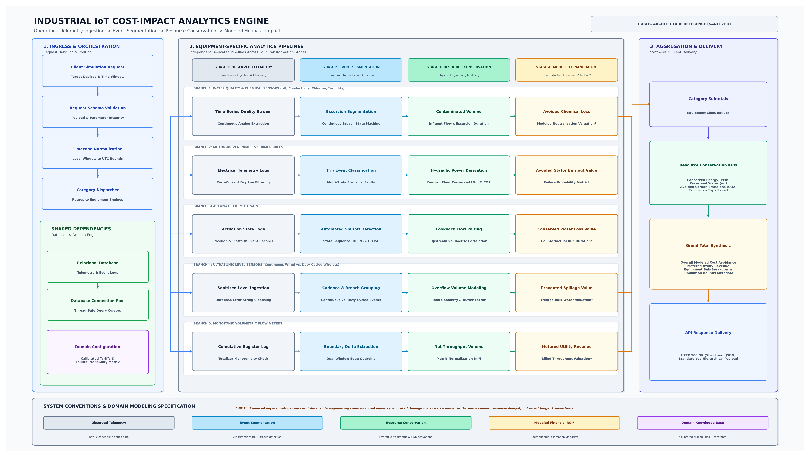

# Industrial IoT Cost-Impact Analytics Backend

> Transforms raw industrial IoT telemetry into equipment-level operational insights and modeled financial-impact estimates across water utility infrastructure.

---

## Introduction

Industrial water utilities and processing facilities deploy thousands of connected assets—submersible pumps, motorized control valves, water-quality analyzers, ultrasonic tank level transmitters, and volumetric flow meters. While operational platforms monitor live sensor readings and trigger static threshold alarms, plant operators and executive decision-makers face an ongoing challenge: **quantifying the tangible operational and financial return generated by automated supervisory actions compared to manual workflows.**

Converting raw telemetry into business-relevant metrics is difficult because raw data cannot be directly aggregated into financial insights:
- **Equipment classes operate under distinct physical constraints:** Evaluating a pump requires hydraulic and electrical power modeling; analyzing an automated valve requires state-transition detection and lookback flow correlation; evaluating a water-quality sensor requires contiguous temporal excursion tracking; and processing a flow meter requires boundary-delta extraction from cumulative totalizers.
- **Physical events precede financial valuation:** Quantifying avoided operational losses requires first deriving physical conservation metrics (conserved kilowatt-hours, preserved water volume, averted chemical contamination, and prevented carbon emissions).
- **Financial impact requires counterfactual modeling:** An averted pump burnout or prevented tank spillage leaves no direct accounting entry; quantifying avoided operational losses requires defensible, domain-calibrated assumptions (*"What losses would have accumulated during traditional manual operator response delays?"*).

This analytics backend addresses these challenges by processing multi-device telemetry through dedicated analytical pipelines, connecting physical operational events directly with defensible resource and cost-impact models.

---

## Architecture Preview



The backend executes an on-demand, four-stage analytical pipeline:
1. **Ingress & Orchestration:** Ingests simulation requests, validates schemas, localizes calendar periods to standardized UTC SQL bounds, and partitions assets across dedicated analytical pipelines.
2. **Shared Persistence & Knowledge:** Fetches time-series telemetry via connection-pooled raw SQL cursors and injects domain-calibrated constants, damage probability matrices, and utility tariffs.
3. **Equipment Analytics Pipelines:** Routes telemetry through five independent engines across four transformation stages (**Stage 1: Observed Telemetry $\rightarrow$ Stage 2: Event Segmentation $\rightarrow$ Stage 3: Resource Conservation $\rightarrow$ Stage 4: Modeled Financial ROI**).
4. **Aggregation & Delivery:** Synthesizes category subtotals, physical resource rollups, and overall modeled financial impact into structured JSON responses.

---

## Core Capabilities

- **Equipment-Specific Telemetry Processing:** Implements independent analytical engines tailored to the operational mechanics of each equipment class without generic calculation loops.
- **Time-Series Event Segmentation:** Uses state machines to isolate contiguous out-of-spec quality excursions and identify multi-state electrical trip episodes.
- **Water-Quality Excursion Analytics:** Tracks acute breach durations across pH, conductivity, chlorine, and turbidity sensors, modeling contaminated batch volumes and avoided chemical waste.
- **Pump and Motor Impact Modeling:** Derives discharge flow rates from nameplate power and head specifications, evaluating motor burnout prevention, electricity conservation, and carbon abatement.
- **Automated Valve Event Analysis:** Detects automated shutoff state transitions (`OPEN` $\rightarrow$ `CLOSE`), correlating upstream flow rates to model avoided pipeline leakage and technician dispatch savings.
- **Tank-Level and Overflow Analytics:** Sanitizes hardware transducer errors, accommodates continuous wired vs. duty-cycled wireless reporting cadences, and models prevented tank overflow spillage.
- **Cumulative Flow-Meter Processing:** Evaluates monotonic cumulative totalizers, extracting net volumetric consumption via boundary-delta queries without accumulator summation corruption.
- **Resource Conservation Calculations:** Computes concrete physical savings: conserved electrical energy ($\text{kWh}$), preserved liquid volume ($\text{m}^3$), avoided emissions ($\text{kg CO}_2$), and prevented maintenance travel.
- **Modeled Financial-Impact Estimation:** Connects physical operational events to monetary impact estimates using domain-calibrated replacement costs, failure probabilities, and utility tariffs.
- **Aggregated Analytics API Responses:** Delivers hierarchical JSON payloads containing per-device breakdowns, category subtotals, physical resource rollups, and overall simulation grand totals.

---

## Equipment Analytics

| Equipment Category | Analytical Focus | Operational & Economic Derivations |
| :--- | :--- | :--- |
| **Water-Quality Sensors** | Excursion detection and treatment impact modeling | Reconstructs contiguous threshold breaches; sizes contaminated batch volumes; models avoided product loss and corrective chemical neutralization. |
| **Motors and Pumps** | Fault analysis, energy and resource conservation | Classifies electrical trip codes; applies failure probability matrices to estimate prevented stator burnouts; derives flow and conserved kilowatt-hours. |
| **Automated Valves** | State transitions and modeled leakage prevention | Identifies automated shutoffs; queries lookback upstream flow rates; models avoided water loss during assumed manual delay windows. |
| **Level Sensors** | Tank-level analysis and overflow prevention | Handles continuous vs. duty-cycled cadences; cleans hardware dropout strings; integrates tank geometry and buffer factors to model avoided spillage. |
| **Flow Meters** | Cumulative register processing and volume calculations | Evaluates monotonic totalizers; executes dual-boundary delta queries; standardizes volumetric throughput; models metered utility revenue. |

---

## How It Works

```
[ Simulation Request ] 
          │
          ▼
[ 1. Ingress & Validation ] ──► Validates payload schema & converts local dates to UTC query bounds
          │
          ▼
[ 2. Data Retrieval ]       ──► Queries telemetry via connection-pooled parameterized raw SQL cursors
          │
          ▼
[ 3. Clean & Normalize ]    ──► Sanitizes hardware error strings & normalizes engineering units
          │
          ▼
[ 4. Pipeline Routing ]     ──► Partitions devices into dedicated equipment analytical modules
          │
          ▼
[ 5. Event Segmentation ]   ──► Detects contiguous excursion windows, trip codes & state transitions
          │
          ▼
[ 6. Resource Calculations] ──► Derives physical quantities: flow rates, conserved kWh, and batch volume
          │
          ▼
[ 7. Economic Modeling ]    ──► Multiplies physical metrics by calibrated damage tables & tariffs
          │
          ▼
[ 8. Response Delivery ]    ──► Assembles category subtotals, physical KPIs & grand total into JSON
```

---

## Technology Stack

| Layer | Technology | Architectural Role |
| :--- | :--- | :--- |
| **API Framework** | FastAPI (Python 3.10+) | High-performance asynchronous REST gateway, route dispatching, and error handling |
| **Data Validation** | Pydantic | Strict request schema validation, type enforcement, and response serialization |
| **Database Access** | PostgreSQL & SQLAlchemy | Managed connection pooling (`QueuePool`) with connection liveness pre-pings |
| **Query Engine** | Parameterized Raw SQL (`psycopg2`) | Index-accelerated time-window filtering and boundary-delta queries |
| **Mathematical Modeling** | Python & NumPy | First-principles hydraulic calculations, matrix operations, and unit normalization |
| **Timezone Engine** | pytz & datetime | Local-to-UTC boundary localization across multi-calendar simulation modes |
| **Domain Configuration** | Centralized Constants Module | Auditable source of truth for physical constants, damage matrices, and baseline tariffs |

---

## Engineering Highlights

- **Time-Series Event Segmentation:** Replaces point-in-time threshold checks with state machines that track the start, duration, and resolution of continuous excursion episodes.
- **Dedicated Equipment Analytics:** Eliminates generic calculation blocks, ensuring each equipment type is evaluated through physical and operational principles specific to its mechanics.
- **Cumulative Measurement Handling:** Uses SQL boundary-delta queries (`UNION ALL`) to determine net volumetric throughput from monotonic totalizers, preventing odometer compounding corruption.
- **Resilient SQL Telemetry Retrieval:** Employs database-level `NULLIF` casting to prevent hardware diagnostic strings (such as transducer echo dropouts) from crashing numerical aggregations.
- **First-Principles Mathematical Modeling:** Combines fluid mechanics and electrical relationships to derive unmetered discharge rates, pumping energy, and chemical batch volumes.
- **Clear Analytical Separation:** Explicitly distinguishes directly observed sensor measurements, derived operational events, calculated physical conservation metrics, and modeled financial estimates.
- **Decoupled Backend API Architecture:** Separates HTTP ingress, input validation, SQL query execution, equipment processing, and response aggregation into clean architectural layers.

---

## Detailed Documentation

For a comprehensive technical walkthrough of the architecture, data engineering pipelines, mathematical formulas, and forensic metric audits, refer to:

- **[Engineering Case Study (`CASE_STUDY.md`)](CASE_STUDY.md)** — In-depth architectural case study covering domain challenges, state machine design, complete symbolic mathematical equations, query patterns, and role boundaries.
- **[System Architecture Diagram (`architecture.png`)](architecture.png)** — High-resolution landscape architecture visualization.

---

## Limitations and Future Improvements

- **Counterfactual Assumption Dependency:** Financial-impact outputs are modeled estimates dependent on configured parameters (failure probability distributions, baseline utility tariffs, and assumed manual response delays). They represent engineering benchmarks of avoided operational loss rather than audited financial ledger entries.
- **Dynamic Parameter Management:** Future work includes exposing administrative APIs to allow plant managers to update tariffs, labor benchmarks, and equipment replacement tiers dynamically without code redeployment.
- **Asynchronous Execution for Large Fleets:** While on-demand synchronous execution serves current simulation workloads, introducing background task workers (such as Celery with Redis) would optimize multi-year queries across massive device fleets.
- **Probabilistic Modeling:** Implementing range-based sensitivity modeling (lower, expected, and upper bounds) would enhance executive communication regarding the probabilistic nature of counterfactual outcomes.

---

## Engineering Contribution

- **Backend Architecture & Service Implementation:** Designed and built the FastAPI microservice, structuring request models, route orchestration, and hierarchical JSON response delivery.
- **Data Engineering & SQL Query Optimization:** Implemented connection-pooled database interactions, parameterized query construction, time-window filtering, and defensive database-level typecasting.
- **Event Segmentation & Mathematical Formulations:** Formulated and implemented the state machines, first-principles hydraulic derivations, and counterfactual cost models across all equipment classes.
- **Role Boundary:** My contributions were focused entirely on the backend analytics engine, data pipelines, and REST API contracts. Client-side dashboard interfaces, visualizations, and chart rendering were developed by frontend engineering teammates.

